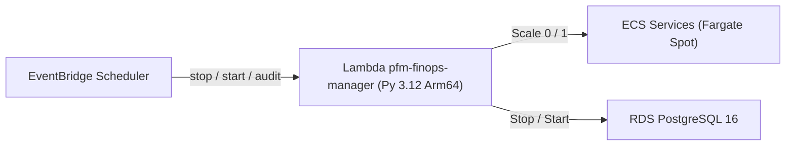

# PFM FinOps Manager Infra — Guardião de Custos & Park/Unpark AWS

[](CONTRIBUTING.md)
[](CHANGELOG.md)
[](https://sorobanerp.github.io/pfm-docs/)

---

## 1. Visão Geral & Papel na Arquitetura

Lambda **Python 3.12 Arm64** idempotente (`pfm-finops-manager`) + EventBridge Scheduler + IAM para gerenciar o ciclo de economia noturna (`stop` 20h30 BRT / `start` 06h00 BRT), auditoria de run-rate (`audit`) e *circuit-breaker* de orçamento.

- **Repositório:** `Sorobanerp/pfm-finops-manager-infra`
- **Vínculo com `pfm-docs`:** `ADR-008, ADR-010 | US-15`



---

## 2. Pré-requisitos & Variáveis de Ambiente

### Pré-requisitos
- Python 3.12+ & `pytest`
- OpenTofu `>= 1.8.0` & Trivy

### Variáveis de Ambiente (Sem Segredos Hardcoded)
| Variável | Padrão | Descrição |
| :--- | :---: | :--- |
| `ECS_CLUSTER_NAME` | `pfm-pilot-prod` | Cluster ECS gerenciado |
| `RDS_INSTANCE_ID` | `pfm-postgres-prod` | Instância RDS alvo |
| `EKS_CLUSTER_NAME` | `pfm-eks-prod` | Cluster EKS (quando ativo) |
| `TF_VAR_enable_nightly_schedule` | `false` | Habilita/desabilita agendamentos EventBridge |

> **Segurança (Zero-Trust):** Nunca commite tokens, senhas, chaves AWS ou strings de conexão com credenciais reais. Utilize `.env` local (ignorado no `.gitignore`) ou AWS Secrets Manager / GitHub OIDC.

---

## 3. Como Executar Localmente

```bash
python3 -m venv .venv && source .venv/bin/activate
pip install -r requirements-dev.txt || pip install pytest boto3
PYTHONPATH=. .venv/bin/pytest -v
```

---

## 4. Como Testar e Validar

```bash
PYTHONPATH=. .venv/bin/pytest -v
tofu fmt -check -recursive terraform/
tofu -chdir=terraform/aws init -backend=false && tofu -chdir=terraform/aws validate
trivy config --severity CRITICAL,HIGH --exit-code 1 terraform/
```

---

## 5. Como Provisionar / Validar na Nuvem

1. Fluxo Gitflow: `feat/*` $\rightarrow$ `develop` $\rightarrow$ `release/vX.Y.Z` $\rightarrow$ `main`.
2. Validação pós-deploy: `aws lambda invoke --function-name pfm-finops-manager --payload '{"action":"audit"}' out.json && cat out.json`.

Consulte [CONTRIBUTING.md](CONTRIBUTING.md) para regras de Conventional Commits e [CHANGELOG.md](CHANGELOG.md) para histórico de versões.
